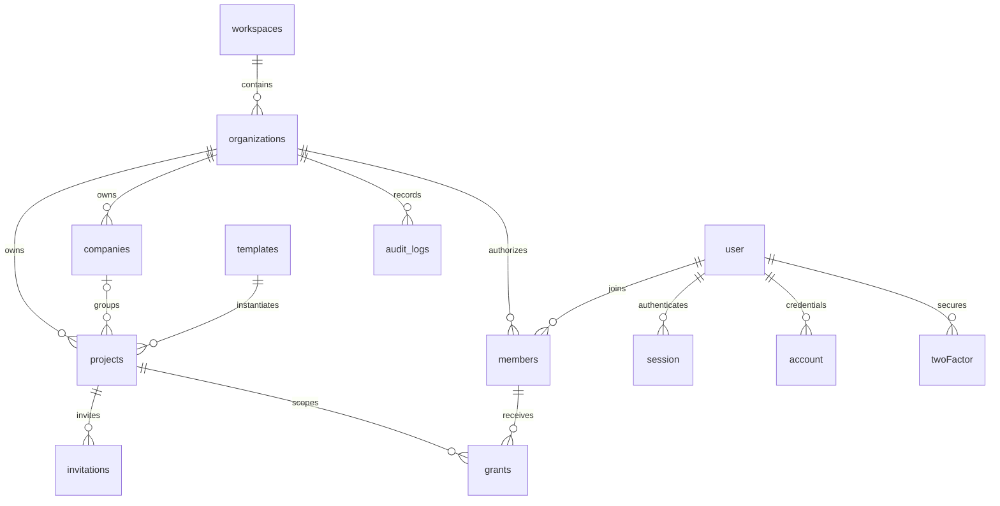

# Data model

Implemented: auth tables user/account/session/verification/twoFactor/rateLimit; workspaces, organizations, companies (self-parenting units/brands), projects, members, grants, invitations, templates, audit_logs and security_events. Profiles live in user + members.job_title. Roles and action definitions are versioned code catalogs; per-project custom profiles are explicit JSON grants. No unnecessary duplicated permission tables.

Access grant: organization + project + user + role + actions by module + active/revoked + source. Global membership: owner/admin/member and active/suspended/deactivated. No grant without membership; no cross-tenant FK. Individual project grant replaces the template; separate projects never inherit one another. Existing invitation/grant conflict requires administrator review instead of merging privileges silently. Status revocation wins. No explicit deny override beyond revoked membership/grant in v1.

Invitation stores a SHA-256 digest of a 256-bit random token, 48-hour expiry and explicit grant snapshot. Acceptance is atomic and requires matching verified email; reuse fails. Administrative changes and actor/target are audited. Sessions expire after 8 hours. MFA setup revokes pre-enrollment sessions.

Future entities: strategic plans, objectives, key results, initiatives, tasks, customers, opportunities, campaigns, accounts, ledger entries, budgets, documents/versions, connectors/sync jobs and metric definitions/observations. They will introduce resource-level policies where individual records need finer authorization. No business ledger or document storage exists yet.

## Planning content increment (local migration 003)

`module_content`: one current document per organization/project/area, schema version 1, optimistic revision, validated area-specific plain-text fields, up to 50 identified information items, last author/time. `module_revisions`: append-only full snapshots with author/time; database trigger rejects updates/deletes. Composite project/organization foreign keys preserve tenant association. Module API rechecks area enabled state, project grants, view/create/edit/delete rights and project archive state. Runtime RLS remains server-only, with tenant/area authorization in the domain. No user data backfill.
